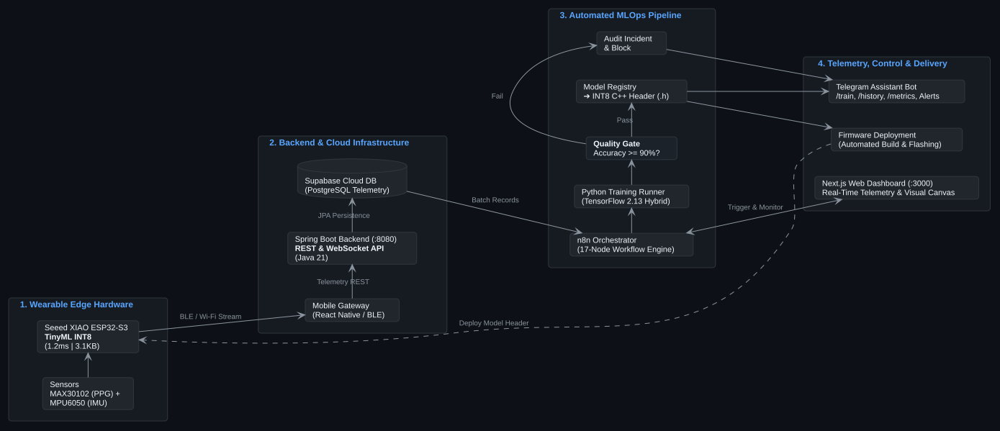

# ⌚ ProWatch AI - Smartwatch Ecosystem & Automated MLOps Pipeline

<p align="center">
  
  
  
  
  
  
  
</p>

---

## 📖 1. Project Overview

**ProWatch AI** is a comprehensive, production-grade healthcare smartwatch ecosystem spanning from Embedded Edge IoT hardware to **Java 21 Spring Boot Backend Microservices**, Cloud infrastructure, and automated **MLOps Continuous Training & Deployment Pipelines**.

The system deploys an ultra-lightweight **TinyML (Multilayer Perceptron)** neural network directly onto the **Seeed Studio XIAO ESP32-S3** microcontroller. This empowers real-time on-device clinical health risk assessment (*Low / Medium / High Risk*) adhering to the international **NEWS2 (National Early Warning Score)** medical protocol with an inference latency of just **1.2 ms** and an ultra-compact memory footprint of **3.1 KB**. Biometric vitals (BPM, SpO2, Accelerometer) are ingested via Bluetooth Low Energy (BLE) and Wi-Fi into the **Spring Boot microservice (:8080)**, synced with **Supabase PostgreSQL Cloud**, and monitored live across Web and Mobile dashboards.

---

## 🏛️ 2. System Architecture

<p align="center">
  
</p>

*Diagram designed with PlantUML. Source specification maintained in [`docs/architecture.puml`](docs/architecture.puml).*

---

## 📂 3. Repository Directory Structure

```text
smart-watch/
├── docs/                           # Architectural diagrams, specifications & SQL schemas
│   ├── architecture.svg            # End-to-end system architecture vector diagram
│   ├── architecture.puml           # PlantUML source code for architecture diagram
│   └── supabase_schema.sql         # Production Supabase PostgreSQL table schemas
│
├── firmware/                       # Embedded C++ firmware for the smartwatch microcontroller
│   ├── xiao_esp32s3_prowatch/      # Arduino / ESP-IDF sketch for XIAO ESP32-S3
│   │   ├── xiao_esp32s3_prowatch.ino
│   │   └── Watch/
│   │       └── health_risk_model_int8.h # Auto-generated C++ byte array embedded into firmware
│   └── README.md                   # Pinout diagram and flashing instructions
│
├── model/riskscore/                # Python AI/ML Service & Training Engine
│   ├── train_model.py              # TinyML MLP training script (HYBRID data mode supported)
│   ├── run_training_service.py     # Lightweight HTTP Task Runner (:5005) bridging n8n
│   ├── telegram_bot_service.py     # Long Polling Telegram Bot remote assistant
│   ├── telegram_config.json        # Telegram Bot Token & Supabase credentials
│   ├── artifacts/                  # Registry storing 5 training artifacts (.keras, .tflite, .h, metrics)
│   │   ├── health_risk_model.keras
│   │   ├── health_risk_model_int8.h
│   │   ├── health_risk_model_int8.tflite
│   │   ├── scaler.pkl
│   │   ├── label_encoder.pkl
│   │   ├── training_metrics.json   # Latest evaluation metrics and confusion matrix
│   │   └── training_history.json   # Historical training audit trail for Bot & Dashboard
│   └── data/                       # WESAD clinical baseline datasets (.gitignore ignored)
│
├── n8n/                            # MLOps Orchestration Engine
│   ├── docker-compose.yml          # Docker Compose configuration for n8n container (:3636)
│   └── workflows/
│       └── automated_training_pipeline.json # Complete 17-Node production training pipeline
│
├── web/                            # Next.js 14 Web Dashboard (:3000)
│   ├── src/
│   │   ├── app/                    # Next.js 14 App Router & API routes
│   │   │   └── api/n8n/route.ts    # Webhook bridge proxying requests to n8n
│   │   ├── components/
│   │   │   ├── PipelineTab.tsx     # 17-Node visual SVG canvas & execution history table
│   │   │   ├── OverviewTab.tsx     # Real-time biometric monitoring & AI radar cards
│   │   │   └── AnalyticsTab.tsx    # Longitudinal trends & NEWS2 distribution charts
│   │   └── services/
│   │       ├── pipelineLogs.ts     # Action Runner terminal logs generator
│   │       └── mockData.ts         # Realistic fallback data records
│   └── package.json
│
├── mobile/                         # Mobile companion & backend services
│   ├── backend/                    # Spring Boot 3 & Java 21 REST/WebSocket microservice (:8080)
│   │   ├── src/main/java/com/huudan/backend/ # Controllers (Health, Device), Services, JPA Entities
│   │   ├── src/main/resources/     # application.yaml (Local H2 & Supabase PostgreSQL pooler)
│   │   └── pom.xml                 # Maven configuration (Security, Actuator, JPA, WebSocket)
│   ├── frontend/                   # React Native / Expo companion app
│   └── ProWatch-Health.apk         # Pre-compiled standalone Android APK package
│
├── supabase/                       # Supabase Cloud Database schema & migrations
│   └── create_activities_and_update_health_records.sql
│
├── port_manager.py                 # Port management CLI, HTTP healthchecker, and cache cleaner
├── start_services.ps1              # 1-Click PowerShell launcher for all local services
└── .gitignore                      # Multi-tier project exclusion rules
```

---

## ⚡ 4. Network Ports & Microservices

| Port | Microservice | Stack | Healthcheck Endpoint |
| :---: | :--- | :--- | :--- |
| **`8080`** | **Spring Boot Backend** | Java 21 / Spring Boot 3 (JPA, WebSocket) | `http://localhost:8080/prowatch/actuator/health` |
| **`3000`** | **Web Dashboard** | Next.js 14 / React 18 | `http://localhost:3000` |
| **`3636`** | **n8n Orchestrator** | Docker Container | `http://localhost:3636/healthz` |
| **`5005`** | **Python ML Task Runner** | Python Standard HTTP Server | `http://localhost:5005/health` |
| **Cloud** | **Supabase Database** | PostgreSQL Cloud REST API | `https://[project-id].supabase.co` |
| **Cloud** | **Telegram Bot Assistant** | Python Long Polling | Listens to Telegram Bot API |

---

## 🚀 5. Quick Start Guide

### Prerequisites:
- **Operating System:** Windows 10/11 (or macOS / Linux).
- **Java Development Kit (JDK):** v17 or v21+ (for Spring Boot backend).
- **Node.js:** v18.x or v20.x+.
- **Python:** v3.10 or v3.11 (virtual environment with TensorFlow recommended).
- **Docker Desktop:** Running (to host n8n).

---

### Option 1: 1-Click Startup via PowerShell (Recommended)
Open PowerShell at the project root directory and execute:
```powershell
.\start_services.ps1
```
The script will automatically:
1. Verify and start Docker container `n8n_prowatch` on port `:3636`.
2. Launch the Python ML Task Runner in a standalone window on port `:5005`.
3. Launch the Next.js Web Dashboard in a standalone window on port `:3000`.
4. Spin up the background Telegram Bot Listener.

---

### Option 2: Interactive CLI via `port_manager.py`
Run the terminal management tool:
```bash
python port_manager.py
```
Key menu options:
- **`[1]`**: Inspect listening ports and process IDs (PID).
- **`[3]`**: Run live HTTP healthchecks across all endpoints.
- **`[4]`**: Forcefully kill and release zombie/hung ports.
- **`[5]`**: Launch individual microservices (`3000`, `3636`, `5005`).
- **`[6]`**: Start the Telegram Bot Listener.
- **`[7]`**: Clean up `__pycache__` and residual build cache files.
- **`[10]`**: View TinyML model training run history and Quality Gate audit logs (`--history`).

---

## 🔄 6. Production 17-Node MLOps Pipeline (`automated_training_pipeline.json`)

The automated pipeline orchestrates full continuous training with rigorous quality assurance:

```text
[Triggers] (Webhook POST / Schedule Cron 02:00 Sun / Manual Test)
    │
    ▼
[Fetch Supabase Data] ── Pulls 50 latest smartwatch sensor measurements via REST API
    │
    ▼
[Pre-flight Validation] ── Labels records with NEWS2 rules & computes Z-Score standardization
    │
    ▼
[Train Model (Python)] ── Executes TinyML MLP training via :5005 (HYBRID data strategy)
    │
    ▼
[Extract Metrics] ── Extracts Test Accuracy, Macro F1-Score, and Loss from metrics JSON
    │
    ▼
[Quality Gate] ── Strict gate condition: Test Accuracy >= 90.00%
    ├── TRUE (Quality Standard Met)
    │     ├── [Handle Success]
    │     ├── [Sync Model Registry] ── Archives 5 artifacts into versioned registry
    │     ├── [Sync Firmware Header] ── Quantizes model to INT8 & generates health_risk_model_int8.h
    │     ├── [Format Success Card]
    │     └── [Send Telegram Alert] ── Dispatches green success audit card to Telegram Admin
    │
    └── FALSE (Quality Standard Breached / Execution Failure)
          ├── [Handle Failure] ── Aborts firmware sync to prevent uploading corrupt weights
          ├── [Log Audit Incident] ── Records incident ticket INC-... to the audit trail
          ├── [Format Alert Card]
          └── [Send Incident Alert] ── Dispatches high-priority incident alert to Telegram
```

---

## 🤖 7. Remote Control via Telegram Bot

Communicate with your ProWatch assistant via Telegram using the following slash commands:

| Command | Description |
| :--- | :--- |
| **`/train`** | Triggers an immediate model retraining run on the host and returns metrics in ~4 seconds. |
| **`/history`** | Displays the last 5 training runs with accuracy, loss, F1, and Quality Gate PASS/FAIL status. Supports custom limit (e.g. `/history 10`). |
| **`/status`** | Checks live health of Web Dashboard (`:3000`), n8n (`:3636`), Python Runner (`:5005`), and hardware USB connection. |
| **`/metrics`** | Reports current model metrics, training sample size, and C++ INT8 array memory footprint. |
| **`/health`** | Retrieves the latest live Heart Rate (BPM), SpO2, and activity telemetry from Supabase Cloud. |
| **`/clean`** | Scans and deletes Python `__pycache__` and `.pyc` files safely. |
| **`/help`** | Displays detailed user guide and command options. |

---

## 🩺 8. TinyML Model Specifications

- **Neural Architecture:** Multilayer Perceptron (MLP)
  - `Input Layer`: 6 physiological features (`heart_rate`, `spo2`, `bmi`, `weight`, `height`, `temperature`).
  - `Hidden Layer 1`: 16 units, ReLU activation function.
  - `Hidden Layer 2`: 8 units, ReLU activation function.
  - `Output Layer`: 3 units, Softmax activation function (*Class 0: Low, Class 1: Medium, Class 2: High Risk*).
- **Trainable Parameters:** 275 weights and biases.
- **INT8 Post-Training Quantization Footprint:** **3,104 bytes (~3.03 KB)**.
- **Required SRAM Tensor Arena on ESP32-S3:** **< 35 KB** (comfortably within the 512 KB internal SRAM).
- **Edge Inference Latency:** **1.2 ms per sample** (> 800 Hz real-time throughput capability).

---

## 📄 9. License & Authors

- **Project:** ProWatch AI Smartwatch & Automated MLOps Pipeline.
- **Author:** HuuDan.
- **License:** Open for academic research, biomedical engineering, and intelligent wearable development.
