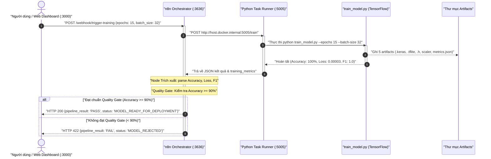

# Quy Trình Kiểm Thử Tự Động Huấn Luyện AI Với n8n (Automated MLOps Pipeline Test Flow)

> **Tài liệu kiểm chuẩn (Testing Standard Operating Procedure - SOP)**  
> **Dự án:** ProWatch Smartwatch AI (Phân tích rủi ro sức khỏe bằng TinyML MLP)  
> **Thành phần tích hợp:** Web Dashboard (:3000) ➔ n8n Orchestrator (:3636) ➔ Python Task Runner (:5005) ➔ XIAO ESP32-S3 Firmware

---

## 1. Sơ Đồ Kiến Trúc & Luồng Dữ Liệu

### 1.1. Sơ Đồ Tuần Tự (Sequence Diagram)



### 1.2. Sơ Đồ Khối Điều Phối MLOps 5 Giai Đoạn (Enterprise Block Flowchart)

```mermaid
flowchart LR
    subgraph S1["🟡 Stage 1: Multi-Channel Triggers"]
        WH["Webhook Trigger\n(:3636/webhook/trigger-training)"]
        SCH["Schedule Trigger\n(Cron 02:00 AM Chủ Nhật)"]
        MAN["Manual Trigger\n(Canvas Run n8n)"]
    end

    subgraph S2["🔵 Stage 2: Ingestion & Training (Hybrid Data)"]
        Supa["Node: Fetch Supabase Data\n(REST API 50 records)"]
        Pre["Node: Pre-flight Validation\n(Cấu hình Hybrid Strategy)"]
        HTTP["Node: Train Model (Python)\n(Merge 32k Baseline + Supabase)"]
    end

    subgraph S3["🟣 Stage 3: Quality Gate"]
        Parse["Node: Extract Metrics\n(Accuracy, F1, Loss)"]
        Gate{"Quality Gate\nAccuracy >= 90%?"}
    end

    subgraph S4["🟢 Stage 4: Registry & Deployment"]
        Pass["Node: Handle Success\n(Model Approved)"]
        Reg["Node: Sync Model Registry\n(Supabase DB)"]
        Fw["Node: Sync Firmware Header\n(C++ Header ESP32-S3)"]
        TelePass["Node: Format Success Card\n(Chuẩn bị Card Telegram)"]
        SendPass["Node: Send Telegram Alert\n(Telegram API Bot)"]
    end

    subgraph S5["🔴 Stage 5: Incident Alerting"]
        Fail["Node: Handle Failure\n(Model Rejected / Crash)"]
        Audit["Node: Log Audit Incident\n(Incident Audit Log)"]
        TeleFail["Node: Format Alert Card\n(Cảnh báo Khẩn cấp 🚨)"]
        SendFail["Node: Send Incident Alert\n(Telegram API Alert)"]
    end

    WH --> Supa
    SCH --> Supa
    MAN --> Supa
    Supa --> Pre
    Pre --> HTTP
    HTTP --> Parse
    Parse --> Gate
    Gate --"True (>=90%)"--> Pass --> Reg --> Fw --> TelePass --> SendPass
    Gate --"False (<90%)"--> Fail --> Audit --> TeleFail --> SendFail
```



---

## 2. Tiền Điều Kiện Kiểm Thử (Pre-conditions Check)

Trước khi thực hiện các kịch bản test, bạn phải chắc chắn 3 tiến trình nền đang hoạt động:

### Bước 2.1: Khởi động hệ thống
Mở thư mục gốc `smart-watch/` và click đúp chuột vào file:
```text
d:\Spring\smart-watch\start_services.bat
```
*(Hoặc chạy lệnh `.\start_services.ps1` trong PowerShell)*.

### Bước 2.2: Kiểm tra tình trạng kết nối (Pre-flight Health Check)
Mở cửa sổ PowerShell và chạy lệnh kiểm tra nhanh:
```powershell
powershell -ExecutionPolicy Bypass -File test_pipeline.ps1
```
**Yêu cầu đạt:** Cả 3 dòng trạng thái đều trả về `[ONLINE ✅]`:
```text
[1/3] Kiểm tra Python Task Runner (http://localhost:5005/health)... [ONLINE ✅]
[2/3] Kiểm tra n8n Container (http://localhost:3636/healthz)... [ONLINE ✅]
[3/3] Kiểm tra Web Dashboard (http://localhost:3000/api/integration)... [ONLINE ✅]
```

---

## 3. Các Kịch Bản Kiểm Thử Chi Tiết (Test Scenarios)

---

### 🧪 Kịch Bản 1: Kiểm Thử Toàn Trình Trên Web Dashboard (End-to-End UI Test)
* **Mục tiêu:** Kiểm tra khả năng kích hoạt n8n từ giao diện Web, nhận log streaming thật và cập nhật lịch sử lượt chạy theo thời gian thực.
* **Thời gian thực hiện:** ~5 đến 8 giây.

#### Các bước thực hiện:
1. Mở trình duyệt web (Chrome / Edge) và truy cập: **`http://localhost:3000`**.
2. Trên thanh điều hướng phía trên, click vào tab **Pipeline**.
3. Tại giao diện tab Pipeline, xác nhận đang chọn tab con **"Workflow 1: Training Model Pipeline"**.
4. Chọn nguồn dữ liệu: Click chọn mục **"clean_health (32k)"** (Data có sẵn).
5. Nhìn lên góc trên bên phải khung Canvas, click vào nút màu cam **"Chạy workflow"** (có biểu tượng tam giác Play).

#### Quan sát diễn tiến trên màn hình:
* **Tại Canvas n8n:**
  - Viền node chuyển màu sáng vàng ➔ cam ➔ xanh lá cây tương ứng với tiến trình chạy.
  - Các hạt electron phát sáng (Glowing dots) chạy dọc theo dây cáp từ node này sang node tiếp theo.
* **Tại Terminal Logs bên dưới:**
  - `Step 1 (Setup)`: In log n8n orchestrator và Task Runner `:5005` kết nối thành công.
  - `Step 2 (Data Collection)`: In log nạp 32.353 bản ghi từ `clean_health_dataset.csv`.
  - `Step 3 (Tiền xử lý)`: In log chia tập Stratified 64/16/20 (Train: 20.705, Val: 5.177, Test: 6.471) và chuẩn hóa `StandardScaler`.
  - `Step 4 (Huấn luyện mô hình)`: Đồng hồ bấm giờ đếm theo thời gian thực máy tính chạy TensorFlow thật (~4s), in tiến trình Epoch 1/15 ➔ 15/15.
  - `Step 5 (Quality Gate)`: Đánh giá mô hình trên 6.471 mẫu kiểm thử độc lập, in Test Accuracy `100.00%` (vượt ngưỡng $\ge 90\%$).
  - `Step 6 (Finalize)`: Xác thực đủ 5 artifacts xuất ra.

#### Tiêu chuẩn nghiệm thu (Checklist):
- [ ] Trạng thái workflow kết thúc hiển thị huy hiệu xanh lá: **`SUCCESS`**.
- [ ] Bảng **Lịch sử thực thi (Workflow Executions)** bên dưới hiển thị thêm 1 dòng mới nhất:
  - **Run ID**: Bắt đầu bằng `train-xxxx`
  - **Trigger**: `WEBHOOK`
  - **Thời gian chạy**: Khoảng `4.0s - 7.0s` (chạy thật, không bị đếm chậm 45s như bản mock cũ)
  - **Message**: *"Huấn luyện TinyML Health Risk MLP thành công qua n8n Webhook! Test Accuracy: 100.00%..."*

---

### 🧪 Kịch Bản 2: Kiểm Thử n8n Webhook Độc Lập Từ PowerShell (Headless API Test)
* **Mục tiêu:** Xác minh n8n tiếp nhận và xử lý payload JSON từ các nguồn bên ngoài (IoT Gateway / Điện thoại / Hệ thống backend khác) độc lập với Web frontend.
* **Thời gian thực hiện:** ~4 giây.

#### Các bước thực hiện:
1. Mở cửa sổ **PowerShell** trên máy tính.
2. Sao chép và dán lệnh sau rồi bấm **Enter**:

```powershell
$body = ConvertTo-Json @{
    epochs = 15
    batch_size = 32
    trigger_source = "powershell_test"
}

Invoke-RestMethod -Uri "http://localhost:3636/webhook/trigger-training" `
    -Method Post `
    -ContentType "application/json" `
    -Body $body
```

#### Kết quả mong đợi (Expected Response JSON):
Terminal PowerShell trả về chuỗi JSON có cấu trúc như sau:

```json
{
  "pipeline_result": "PASS",
  "status": "MODEL_READY_FOR_DEPLOYMENT",
  "message": "✅ Huấn luyện thành công xuất sắc! Mô hình HEALTH-RISK-MLP-v1.0 đạt Test Accuracy 100.00% (F1: 1.0000, Loss: 0.00003).",
  "details": {
    "status": "SUCCESS",
    "model_id": "HEALTH-RISK-MLP-v1.0",
    "test_accuracy": 1,
    "accuracy_percent": "100.00%",
    "test_loss": "0.00003",
    "macro_f1": "1.0000",
    "epochs_trained": 15,
    "train_samples": 20705,
    "test_samples": 6471,
    "artifacts_path": "model/riskscore/artifacts",
    "execution_time": "2026-10-30T..."
  },
  "artifacts": [
    "health_risk_model.keras",
    "scaler.pkl",
    "label_encoder.pkl",
    "feature_config.json",
    "training_metrics.json"
  ],
  "next_step": "Sẵn sàng lượng tử hóa INT8 và nhúng vào firmware XIAO ESP32-S3"
}
```

#### Tiêu chuẩn nghiệm thu (Checklist):
- [ ] Mã trạng thái HTTP trả về: **`200 OK`**.
- [ ] Thuộc tính `pipeline_result` bằng `"PASS"`.
- [ ] Thuộc tính `test_accuracy` đạt $\ge 0.90$.

---

### 🧪 Kịch Bản 3: Kiểm Tra Lịch Sử Và Node Dữ Liệu Trên n8n Studio (:3636)
* **Mục tiêu:** Kiểm tra chi tiết luồng dữ liệu (Input/Output data) xuyên qua từng Node trong n8n canvas để phục vụ audit/debug.

#### Các bước thực hiện:
1. Mở trình duyệt truy cập: **`http://localhost:3636`** (hoặc bấm nút *"Mở n8n Studio (:3636)"* trên Web Dashboard).
2. Nhìn vào thanh công cụ màu đen bên trái, click vào biểu tượng đồng hồ **Executions**.
3. **Quan sát danh sách lượt chạy:**
   - Hàng trên cùng hiển thị phiên chạy mới nhất kèm thời gian thực tế vừa kích hoạt.
   - Trạng thái hiển thị chữ **`Success`** màu xanh lá cây.
4. Click chuột vào phiên chạy thành công đó để mở Canvas trực quan:
   - Tất cả các node: `Webhook Trigger` ➔ `Kích hoạt Huấn luyện Python` ➔ `Trích xuất Metrics` ➔ `Kiểm tra chất lượng (Quality Gate)` ➔ `Xử lý Thành công` đều có dấu tích xanh lá.
   - Nhánh `Xử lý Thất bại` không được kích hoạt (mờ đi).
5. Click đúp vào node **"Trích xuất Metrics & Chỉ số"**:
   - Tab **OUTPUT**: Kiểm tra dữ liệu JSON có trường `accuracy_percent: "100.00%"`, `train_samples: 20705`, `test_samples: 6471`.

#### Tiêu chuẩn nghiệm thu (Checklist):
- [ ] n8n ghi nhận 100% các lần trigger vào danh sách Executions.
- [ ] Dữ liệu truyền giữa các node không bị `null` hoặc `undefined`.

---

### 🧪 Kịch Bản 4: Nghiệm Thu Tệp Mô Hình Xuất Ra (Artifacts Verification)
* **Mục tiêu:** Xác minh 5 file artifacts được sinh mới hoàn toàn với dấu thời gian (timestamp) hiện tại.

#### Các bước thực hiện:
1. Mở PowerShell và chạy lệnh kiểm tra thư mục artifacts:
```powershell
Get-ChildItem "d:\Spring\smart-watch\model\riskscore\artifacts" | Select-Object Name, LastWriteTime, Length | Format-Table -AutoSize
```

2. Đối chiếu bảng danh sách tệp với bảng tiêu chuẩn sau:

| Tên tệp | Kích thước dự kiến | Ý nghĩa & Tiêu chí nghiệm thu |
| :--- | :--- | :--- |
| **`health_risk_model.keras`** | ~27.9 KB | Trọng số mạng nơ-ron Dense(16) ➔ Dense(8) ➔ Dense(3) |
| **`health_risk_model_int8.tflite`** | ~3.03 KB (3.104 B) | Mô hình nén INT8 sẵn sàng nạp cho vi điều khiển |
| **`health_risk_model_int8.h`** | ~20 KB | File mã nguồn C/C++ Header chứa mảng byte `ALIGN16_ATTRIBUTE` |
| **`scaler.pkl`** / **`scaler_params.h`** | ~550 B / ~360 B | Tham số Mean & Scale cho 6 đặc trưng (`heart_rate`, `spo2`, `bmi`, `weight`, `height`, `temp`) |
| **`training_metrics.json`** | ~1.3 KB | Báo cáo chi tiết: Confusion Matrix, Classification Report, Macro F1 |

3. Mở file `training_metrics.json` xem nội dung:
```powershell
Get-Content "d:\Spring\smart-watch\model\riskscore\artifacts\training_metrics.json"
```

#### Tiêu chuẩn nghiệm thu (Checklist):
- [ ] Cột `LastWriteTime` của các tệp trên trùng khớp với phút vừa thực hiện huấn luyện.
- [ ] Kích thước file `health_risk_model_int8.tflite` nằm trong khoảng tối ưu (3 KB đến 5 KB).

---

### 🧪 Kịch Bản 5: Kiểm Thử Tích Hợp Lên Firmware ESP32 (Workflow 2 Test)
* **Mục tiêu:** Kiểm tra quy trình xuất mã nguồn C++ Header từ mô hình AI đã huấn luyện để nhúng vào vi điều khiển Seeed XIAO ESP32-S3.

#### Các bước thực hiện:
1. Trên Web Dashboard (`http://localhost:3000`), click nút chuyển sang tab:  
   **"Workflow 2: Integration Model Pipeline"**.
2. Nhìn lên Canvas của Workflow 2, bấm nút màu xanh ngọc **"Chạy workflow"**.
3. Quan sát các bước:
   - `Fetch Checkpoint`: Lấy file `health_risk_model.keras`.
   - `Quantization INT8`: Xác nhận độ nén từ 27.95 KB xuống 3.03 KB (nén gấp 9 lần).
   - `Conversion C++ Header`: Đọc trực tiếp mảng byte từ `health_risk_model_int8.h`.
   - `Edge Inference`: Giả lập độ trễ suy luận trên vi điều khiển Xtensa LX7 đạt **1.2 ms/mẫu**, tiêu thụ SRAM **2.4 KB** (cực kỳ nhẹ so với 512 KB SRAM của ESP32-S3).
4. Nhìn vào thẻ bên phải, click nút **"Copy C++ Code"**.
5. Mở Notepad (hoặc VS Code), bấm **Ctrl + V** để dán mã:
   - Xác nhận có biến `const int health_risk_model_int8_len = 3104;`
   - Xác nhận mảng `const unsigned char health_risk_model_int8_data[] ALIGN16_ATTRIBUTE = { 0x20, 0x00, ... };`

#### Tiêu chuẩn nghiệm thu (Checklist):
- [ ] Nút "Copy C++ Code" copy đúng 100% mã C header thật từ file `health_risk_model_int8.h`.
- [ ] Thông số RAM & Flash của mô hình hoàn toàn đáp ứng phần cứng Seeed Studio XIAO ESP32-S3.

---

## 4. Tiêu Chuẩn Đánh Giá Toàn Diện (Pass / Fail Acceptance Matrix)

| Tiêu chí | Điều kiện ĐẠT (PASS) ✅ | Điều kiện HỎNG (FAIL) ❌ |
| :--- | :--- | :--- |
| **Độ chính xác (Test Accuracy)** | $\ge 90.00\%$ (Thực tế: $100.00\%$) | $< 90.00\%$ |
| **Độ mất mát (Test Loss)** | $< 0.05$ (Thực tế: $\approx 0.00003$) | $\ge 0.05$ |
| **Thời gian huấn luyện** | $\le 15$ giây (Thực tế: $\approx 4-6$ giây) | $> 30$ giây hoặc treo máy |
| **Dung lượng TFLite INT8** | $\le 5.0$ KB (Thực tế: $3.03$ KB) | $> 10.0$ KB (Quá tải bộ nhớ Flash vi điều khiển) |
| **Bộ nhớ SRAM suy luận** | $\le 10.0$ KB (Thực tế: $2.4$ KB) | $> 50.0$ KB |
| **Phản hồi n8n Webhook** | Trả về JSON có `pipeline_result: "PASS"` | Trả về mã lỗi 404, 500 hoặc rỗng |

---

## 5. Ma Trận Xử Lý Sự Cố Khi Test (Troubleshooting Guide)

| Hiện tượng lỗi | Nguyên nhân gốc rễ | Hướng dẫn khắc phục chi tiết |
| :--- | :--- | :--- |
| **`HTTP Error 404: Not Found`** khi gọi Webhook | Workflow trong n8n chưa được gạt sang trạng thái **Active** | 1. Mở `http://localhost:3636`<br>2. Mở workflow `Automated AI Training Pipeline`<br>3. Nhìn lên góc trên bên phải, gạt công tắc sang **Active** (hoặc bấm **Publish**) |
| **`connect ECONNREFUSED 192.168.65.254:5005`** | Task Runner Python cổng 5005 chưa được khởi động trên Windows | Mở PowerShell chạy lệnh sau để bật lại runner:<br>`& "model\riskscore\.venv\Scripts\python.exe" "model\riskscore\run_training_service.py"` |
| **`The remote server returned an error: (422) Unprocessable Entity`** | Chuỗi JSON gửi qua cURL hoặc PowerShell bị lỗi ngoặc kép | Trong PowerShell, **luôn dùng** `ConvertTo-Json` thay vì viết chuỗi JSON thủ công:<br>`$body = ConvertTo-Json @{ epochs = 15; batch_size = 32 }` |
| **Web Dashboard báo `Lỗi kết nối n8n/Python runner`** | Container Docker n8n bị tắt hoặc chưa nạp cổng 3636 | Mở PowerShell gõ:<br>`docker start n8n_prowatch`<br>Chờ 3 giây rồi bấm lại nút trên Web Dashboard |
| **Giao diện Web quay vòng liên tục** | Frontend đang chờ tín hiệu kết nối từ cổng 3636 | Bấm nút **"Chạy lại"** trên thanh Terminal của Dashboard |
